# AI-Based Urban Open Space Distribution Analysis and Green Infrastructure Optimization Using PSO and AIS

## Overview

The **AI-Based Urban Open Space Distribution Analysis and Green Infrastructure Optimization Using PSO and AIS** project is a data-driven framework designed to analyze the distribution of urban open spaces and explore optimization strategies for green infrastructure planning.

The project uses a dataset containing information about open spaces across different sectors of **Jalandhar, Punjab, India**.

It integrates statistical analysis, machine learning, and nature-inspired optimization techniques to examine existing open-space distributions and evaluate simulated infrastructure allocation strategies.

The project implements:

- **Machine Learning-Based Distribution Analysis**
- **Particle Swarm Optimization (PSO)**
- **Artificial Immune System (AIS)**
- **Sector-Level Priority Assessment**
- **Open Space Allocation Optimization**
- **Data Visualization and Comparative Analysis**
- **Model Evaluation and Result Generation**

The primary objective is to investigate how computational intelligence techniques can support urban planning decisions by identifying differences in open-space counts and exploring alternative allocation strategies.

---

## 1. Project Objectives

The major objectives of this project are:

1. Analyze existing urban open-space distributions across Jalandhar's sectors.
2. Identify sectors with relatively low and high open-space counts.
3. Apply machine learning techniques to establish a predictive modeling baseline.
4. Implement Particle Swarm Optimization for simulated open-space allocation.
5. Implement an Artificial Immune System using clonal selection.
6. Compare optimization methods against baseline allocation strategies.
7. Evaluate sector-level count balance using statistical indicators.
8. Generate visualizations and analytical reports.
9. Save models, configurations, and results for reproducibility.
10. Develop a foundation for intelligent urban green infrastructure planning.

---

## 2. Problem Statement

Urban open spaces are important components of sustainable city development.

However, their distribution may vary significantly across different urban sectors.

Such differences can motivate further investigation into infrastructure availability and planning priorities.

Traditional allocation decisions may involve several factors, including:

- Existing infrastructure
- Population distribution
- Land availability
- Development budgets
- Environmental requirements
- Urban accessibility

This project investigates the following question:

**How can machine learning and nature-inspired optimization techniques be used to analyze sector-level open-space counts and generate alternative allocation strategies under a fixed simulated budget?**

The current dataset supports count-based analysis. Population-adjusted accessibility and actual environmental benefits require additional information.

---

## 3. Dataset Description

### Dataset Name

`OpenSpaces_Jalandhar_2.csv`

### Dataset Location

```text
C:\Users\sagni\Downloads\AI-Based Urban Open Space Distribution Analysis and Green Infrastructure Optimization Using PSO and AIS\OpenSpaces_Jalandhar_2.csv
```

### Dataset Characteristics

| Property | Description |
|---|---|
| Dataset | OpenSpaces_Jalandhar_2.csv |
| City | Jalandhar |
| State | Punjab |
| Country | India |
| Records | 20 |
| Original columns | 8 |
| Geographic unit | Urban sector |
| Main numerical variable | Open-space count |
| Analysis type | Statistical and optimization-based |

### Dataset Attributes

| Attribute | Description |
|---|---|
| City Name | Name of the city |
| Zone Name | Sector or zone identifier |
| Open space name/no | Numeric open-space information |
| Ward Name / Number | Ward information |
| Open space typology | Category of open space |
| Open space area | Area information |
| Number of trees | Tree count information |

**Note:** The available dataset contains missing information in several environmental attributes. The implementation uses the numeric `Open space name/no` field as an open-space count, subject to verification against the dataset documentation.

### Dataset Limitations

The dataset contains only 20 sector-level records.

Important variables such as population, open-space area, land availability, and tree coverage are unavailable.

Consequently, the current implementation focuses on relative count distribution and simulated allocation rather than verified environmental impact assessment.

---

## 4. Proposed System

The project consists of three main analytical components.

### A. Machine Learning-Based Analysis

The machine learning component evaluates whether sector identifiers can be used to estimate existing open-space counts.

Implemented models include:

- Mean Baseline Regressor
- Linear Regression
- Ridge Regression
- Random Forest Regressor

Leave-One-Out Cross-Validation (LOOCV) is used for evaluation because the dataset is small.

### B. Artificial Immune System Optimization

The AIS component implements a clonal selection strategy inspired by biological immune systems.

It uses:

- Antibody population initialization
- Fitness evaluation
- Selection of high-quality solutions
- Cloning
- Hypermutation
- Random solution injection
- Iterative improvement

The objective is to reduce differences in final sector-level open-space counts under a simulated allocation budget.

### C. Particle Swarm Optimization

The PSO component implements a population-based optimization strategy inspired by collective swarm behavior.

It uses:

- Particle initialization
- Velocity updates
- Position updates
- Personal best tracking
- Global best tracking
- Integer allocation repair
- Constraint validation
- Iterative optimization

The objective is identical to the AIS implementation, enabling direct comparison.

---

## 5. System Architecture

```text
                  +------------------------+
                  | Urban Open Space Data  |
                  | OpenSpaces_Jalandhar   |
                  +-----------+------------+
                              |
                              v
                  +------------------------+
                  | Data Preprocessing     |
                  | Cleaning & Validation  |
                  +-----------+------------+
                              |
                              v
                  +------------------------+
                  | Exploratory Analysis   |
                  | Statistical Indicators |
                  +-----------+------------+
                              |
              +---------------+---------------+
              |               |               |
              v               v               v
     +----------------+ +-------------+ +-------------+
     | ML Regression  | | AIS Model   | | PSO Model   |
     | Baselines      | | Optimization| | Optimization|
     +--------+-------+ +------+------+ +------+------+
              |                |               |
              v                v               v
     +----------------+ +-------------+ +-------------+
     | LOOCV Metrics  | | AIS Results | | PSO Results |
     +--------+-------+ +------+------+ +------+------+
              |                |               |
              +----------------+---------------+
                               |
                               v
                  +-------------------------+
                  | Results & Visualization |
                  +------------+------------+
                               |
                               v
                  +-------------------------+
                  | CSV / PNG / PKL / H5    |
                  | YAML / JSON             |
                  +-------------------------+
```

---

## 6. Technologies Used

### Programming Language

**Python 3.10 or later**

### Libraries

| Library | Purpose |
|---|---|
| NumPy | Numerical computation |
| Pandas | Dataset processing |
| Matplotlib | Graph generation |
| Seaborn | Statistical visualization |
| Scikit-learn | Machine learning |
| h5py | HDF5 storage |
| PyYAML | Configuration management |
| JSON | Structured result storage |
| Pickle | Model serialization |
| pathlib | File and directory management |

### Development Environment

- Jupyter Notebook
- Visual Studio Code
- Python
- Windows

---

## 7. Data Preprocessing

The preprocessing pipeline includes:

### Step 1: Data Loading

The dataset is loaded using Pandas.

```python
import pandas as pd

df = pd.read_csv("OpenSpaces_Jalandhar_2.csv")
```

### Step 2: Missing Value Handling

Rows missing required city, sector, or open-space count information are excluded.

Unavailable environmental attributes are not artificially populated.

### Step 3: Data Type Conversion

Open-space count values are converted into numeric format.

### Step 4: Sector Identification

Numeric sector identifiers are extracted from sector names.

### Step 5: Data Validation

The pipeline checks:

- Required columns
- Missing values
- Nonnegative counts
- Valid sector identifiers
- Duplicate sector records

### Step 6: Feature Preparation

The machine learning component uses sector number as the available numerical predictor.

This variable is an identifier rather than a verified causal predictor.

---

## 8. Exploratory Data Analysis

Exploratory Data Analysis (EDA) is performed to understand the distribution of open spaces.

The analysis includes:

- Total listed open spaces
- Sector-wise counts
- Mean and median
- Standard deviation
- Minimum and maximum counts
- Distribution categories
- Relative priority scores
- Gini coefficient

### Statistical Measures

#### Mean

The average open-space count is calculated as:

\[
\mu = \frac{1}{n}\sum_{i=1}^{n}x_i
\]

Where:

- \(x_i\) = open-space count in sector \(i\)
- \(n\) = total number of sectors

#### Variance

\[
\sigma^2 = \frac{1}{n}
\sum_{i=1}^{n}(x_i-\mu)^2
\]

Variance measures the dispersion of sector-level counts.

#### Standard Deviation

\[
\sigma = \sqrt{\sigma^2}
\]

#### Gini Coefficient

The Gini coefficient measures the concentration of open-space counts across sectors.

A lower Gini coefficient indicates a more even numerical distribution.

It does not independently establish equitable accessibility or environmental quality.

---

## 9. Machine Learning Models

The project evaluates four regression approaches.

### 9.1 Mean Baseline Regressor

Predicts the mean open-space count from the training observations.

This provides a simple reference model.

### 9.2 Linear Regression

Models a linear relationship between sector number and open-space count.

### 9.3 Ridge Regression

Uses regularization to control regression coefficients.

### 9.4 Random Forest Regressor

Combines multiple decision trees to estimate open-space counts.

### Model Evaluation

Leave-One-Out Cross-Validation is used.

For each iteration:

1. One sector is excluded.
2. The model is trained using the remaining sectors.
3. The excluded sector is predicted.
4. The prediction error is recorded.

The process repeats for every sector.

### Evaluation Metrics

#### Mean Absolute Error

\[
MAE = \frac{1}{n}
\sum_{i=1}^{n}|y_i-\hat{y}_i|
\]

#### Mean Squared Error

\[
MSE = \frac{1}{n}
\sum_{i=1}^{n}(y_i-\hat{y}_i)^2
\]

#### Root Mean Squared Error

\[
RMSE = \sqrt{MSE}
\]

#### Coefficient of Determination

\[
R^2 =
1-\frac{\sum(y_i-\hat{y}_i)^2}
{\sum(y_i-\bar{y})^2}
\]

Lower MAE and RMSE indicate better predictive performance.

Higher R² generally indicates better predictive fit, although R² can be negative.

---

## 10. Model Accuracy Visualization

The following graph compares the cross-validated R² scores of the machine learning models.

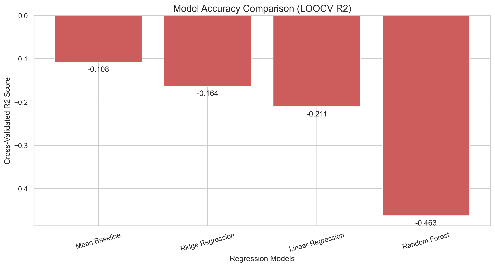

**Figure 1: Machine Learning Model Accuracy Comparison**

The visualization helps compare the predictive performance of:

- Mean Baseline
- Linear Regression
- Ridge Regression
- Random Forest

The graph displays regression R² rather than classification accuracy.

Because the dataset contains only 20 observations and limited predictors, results should be interpreted cautiously.

---

## 11. Artificial Immune System (AIS)

### Introduction

The Artificial Immune System is a nature-inspired computational approach based on principles of biological immune systems.

This project implements an AIS clonal selection algorithm for simulated urban open-space allocation.

### AIS Workflow

```text
Initialize Antibody Population
            |
            v
Evaluate Allocation Fitness
            |
            v
Select High-Affinity Antibodies
            |
            v
Clone Selected Antibodies
            |
            v
Apply Hypermutation
            |
            v
Introduce Random Antibodies
            |
            v
Select Improved Population
            |
            v
Update Best Solution
            |
            v
Repeat Until Final Generation
```

### AIS Optimization Objective

The objective is to minimize the variance of final open-space counts.

\[
\min f(x) =
\frac{1}{n}
\sum_{i=1}^{n}
\left((s_i+x_i)-\bar{s}_{final}\right)^2
\]

Where:

- \(s_i\) = existing open-space count
- \(x_i\) = additional spaces allocated
- \(n\) = number of sectors
- \(\bar{s}_{final}\) = average final open-space count

### Constraints

\[
\sum_{i=1}^{n}x_i = B
\]

\[
0 \leq x_i \leq C_i
\]

Where:

- \(B\) = simulated allocation budget
- \(C_i\) = maximum allocation capacity
- \(x_i\) = nonnegative integer allocation

### AIS Parameters

| Parameter | Value |
|---|---|
| Population size | 50 |
| Generations | 200 |
| Elite antibodies | 10 |
| Clones per elite | 8 |
| Random injections | 8 |
| Maximum mutation transfers | 10 |
| Random seed | 42 |
| Simulated budget | 100 |

### AIS Outputs

```text
ais_accuracy_graph.png
ais_heatmap.png
ais_comparison_graph.png
ais_result.csv
ais_result_graph.png
ais_prediction.csv
ais_prediction_graph.png
ais_convergence.csv
ais_convergence_graph.png
ais_priority_graph.png
ais_model_metrics.csv
ais_model.pkl
ais_model.h5
ais_config.yaml
ais_results.json
```

### AIS Convergence Visualization

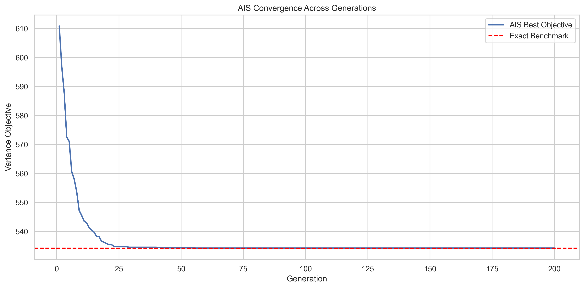

**Figure 2: AIS Optimization Convergence**

The graph tracks the best variance objective across generations.

Lower objective values indicate improved balance in final sector-level counts.

---

## 12. Particle Swarm Optimization (PSO)

### Introduction

Particle Swarm Optimization is a population-based metaheuristic inspired by the collective behavior of swarms.

Each particle represents a candidate allocation of additional open spaces.

Particles iteratively update their positions using personal and global best solutions.

### PSO Workflow

```text
Initialize Particle Swarm
           |
           v
Evaluate Particle Fitness
           |
           v
Update Personal Best
           |
           v
Update Global Best
           |
           v
Update Particle Velocity
           |
           v
Update Particle Position
           |
           v
Repair Integer Allocation
           |
           v
Validate Budget Constraints
           |
           v
Repeat Until Final Iteration
```

### PSO Velocity Update

\[
v_i^{t+1} =
wv_i^t +
c_1r_1(pbest_i-x_i^t) +
c_2r_2(gbest-x_i^t)
\]

Where:

- \(w\) = inertia weight
- \(c_1\) = cognitive coefficient
- \(c_2\) = social coefficient
- \(r_1,r_2\) = random values
- \(pbest\) = personal best
- \(gbest\) = global best

### Position Update

\[
x_i^{t+1}=x_i^t+v_i^{t+1}
\]

Continuous positions are converted into feasible integer allocations using a repair procedure.

### PSO Parameters

| Parameter | Value |
|---|---|
| Swarm size | 50 |
| Iterations | 200 |
| Initial inertia | 0.9 |
| Final inertia | 0.4 |
| Cognitive coefficient | 1.5 |
| Social coefficient | 1.5 |
| Velocity limit | 20 |
| Random seed | 42 |
| Simulated budget | 100 |

### PSO Outputs

```text
pso_accuracy_graph.png
pso_heatmap.png
pso_comparison_graph.png
pso_result.csv
pso_result_graph.png
pso_prediction.csv
pso_prediction_graph.png
pso_convergence.csv
pso_convergence_graph.png
pso_priority_graph.png
pso_model_metrics.csv
pso_model.pkl
pso_model.h5
pso_config.yaml
pso_results.json
```

### PSO Convergence Visualization

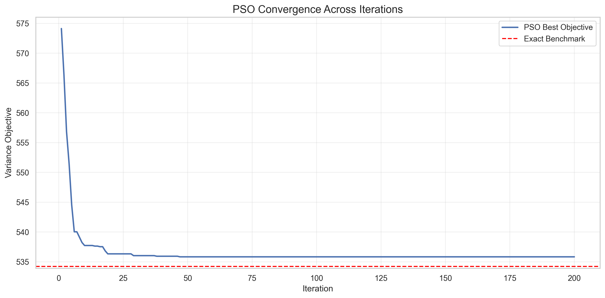

**Figure 3: PSO Optimization Convergence**

The graph illustrates how the best objective value changes during PSO iterations.

---

## 13. Optimization Strategy

The optimization problem is formulated as a fixed-budget resource allocation task.

### Decision Variables

\[
X = [x_1,x_2,\ldots,x_n]
\]

Each decision variable represents the number of additional open spaces assigned to a sector.

### Objective

Minimize the variance of final open-space counts.

### Constraints

- All allocations must be nonnegative integers.
- The total allocation must equal the simulated budget.
- Optional sector capacity limits must be respected.
- Existing open-space counts remain unchanged.

### Simulated Allocation Budget

The implementation uses:

```python
ADDITIONAL_SPACES = 100
```

This value represents a hypothetical planning scenario.

It is not an official municipal infrastructure budget.

---

## 14. Baseline Optimization Strategy

The project includes a greedy allocation strategy.

At each step, the algorithm allocates one additional open space to the eligible sector with the lowest current final count.

For the current equal-weight variance objective, this strategy provides an exact optimal benchmark.

Consequently, AIS and PSO may match the greedy solution rather than outperform it.

This benchmark is important for validating optimization performance.

---

## 15. Optimization Evaluation Metrics

### Variance Reduction

\[
Reduction(\%) =
\frac{V_{initial}-V_{optimized}}
{V_{initial}}\times100
\]

Where:

- \(V_{initial}\) = original variance
- \(V_{optimized}\) = variance after allocation

### Optimality Gap

\[
Gap(\%) =
\frac{f_{algorithm}-f_{optimal}}
{f_{optimal}}\times100
\]

This expression applies when the optimal objective value is positive.

If the optimal objective equals zero, the objective difference should be reported instead.

### Additional Indicators

- Standard deviation
- Gini coefficient
- Minimum sector count
- Maximum sector count
- Total allocated spaces
- Convergence behavior

---

## 16. Comparative Analysis

The project supports comparison of the following approaches:

| Method | Role |
|---|---|
| Original distribution | Initial baseline |
| Greedy allocation | Exact optimization benchmark |
| AIS | Nature-inspired optimization |
| PSO | Swarm-based optimization |

### Comparison Criteria

1. Final objective value
2. Variance reduction
3. Gini coefficient
4. Optimality gap
5. Convergence speed
6. Computational runtime
7. Stability across independent runs

### AIS Comparison Graph

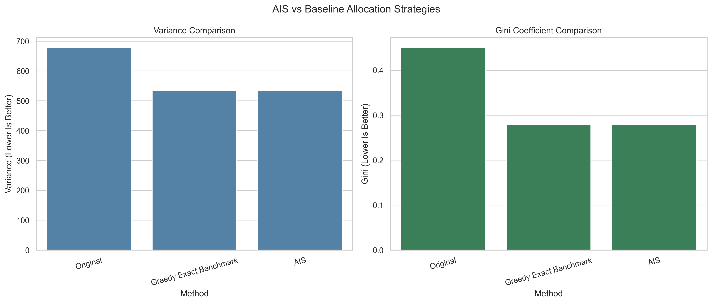

**Figure 4: AIS Allocation Performance**

### PSO Comparison Graph


**Figure 5: PSO Allocation Performance**

The graphs compare optimization methods against the original distribution and greedy benchmark.

Actual numerical performance should be obtained from the generated CSV files rather than assumed in advance.

---

## 17. Data Visualization

The project generates multiple visualizations for exploratory analysis and optimization assessment.

### 17.1 Machine Learning Accuracy


Compares regression models using LOOCV R².

### 17.2 Correlation Heatmap

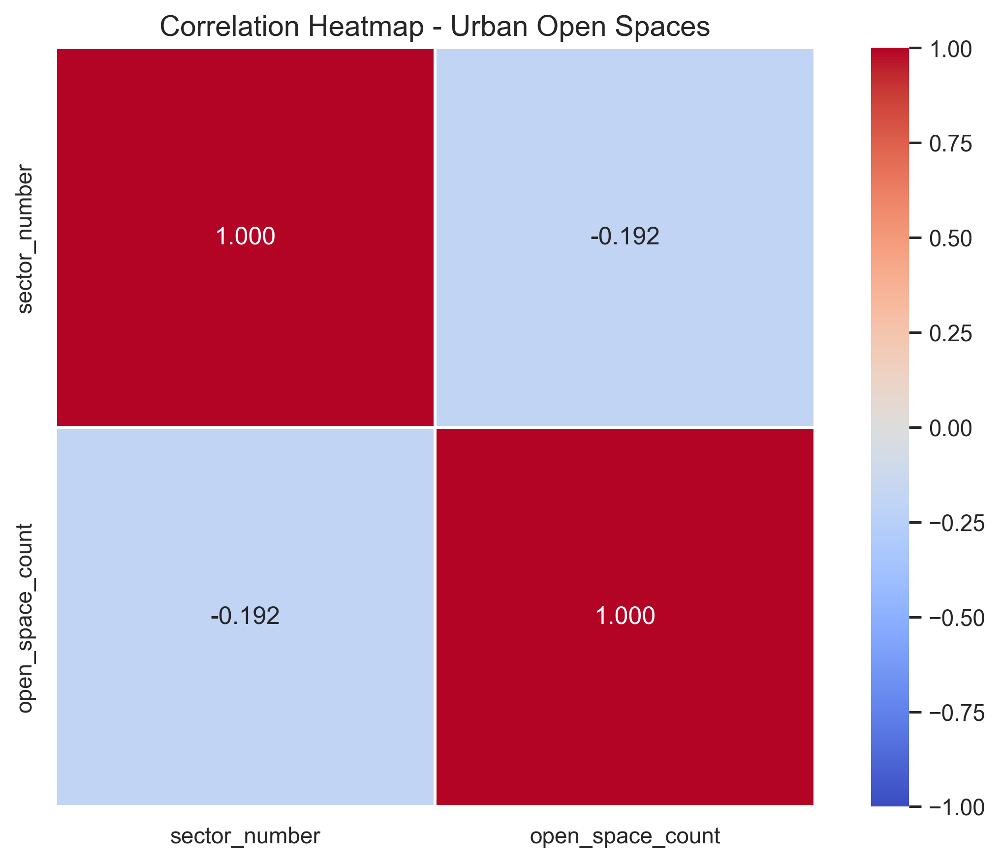

Displays correlations between the available numerical variables.

### 17.3 Machine Learning Comparison

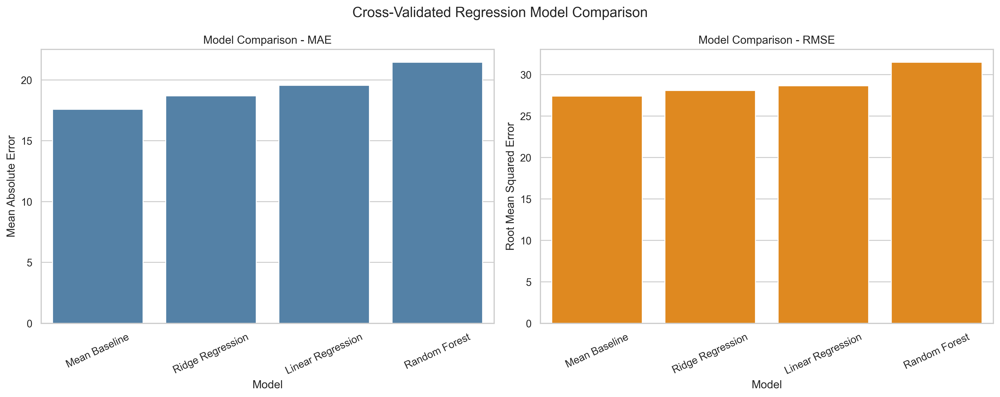

Compares MAE and RMSE across regression models.

### 17.4 Actual vs Predicted Results

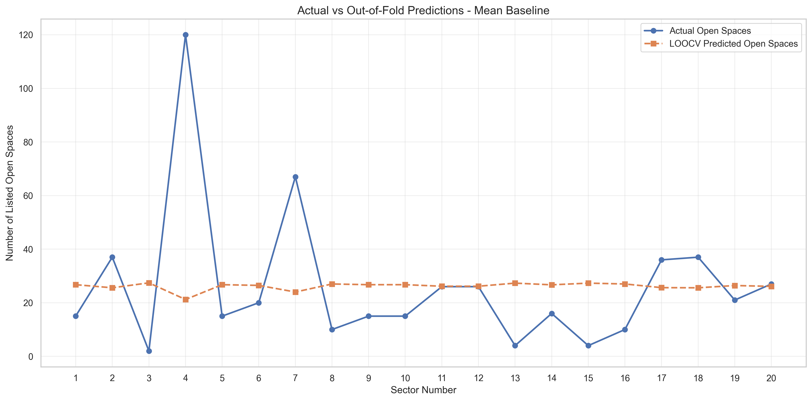

Shows actual open-space counts and out-of-fold regression estimates.

### 17.5 Model Prediction Visualization

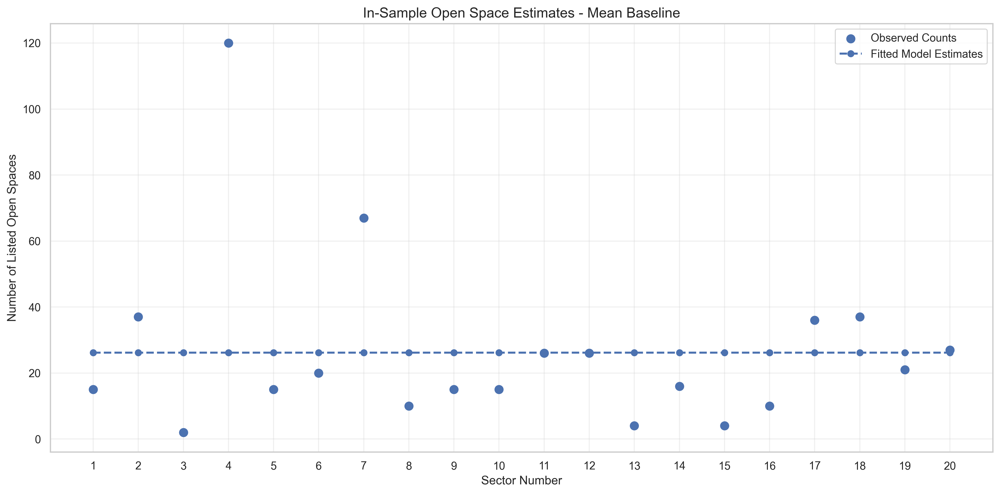

Displays fitted estimates for the observed sectors.

### 17.6 AIS Allocation Heatmap

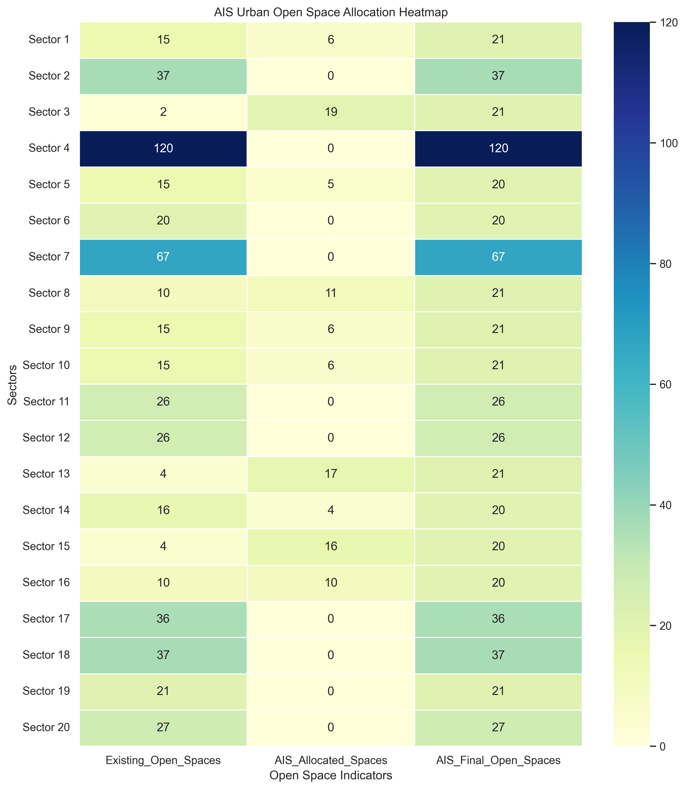

Shows existing counts, AIS allocations, and simulated final counts.

### 17.7 AIS Allocation Results

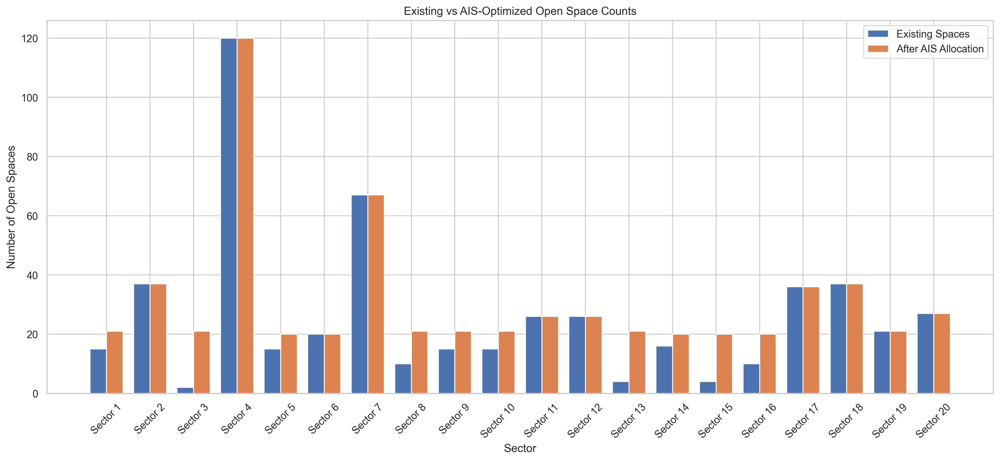

Compares existing counts with the AIS-optimized distribution.

### 17.8 AIS Prediction Results

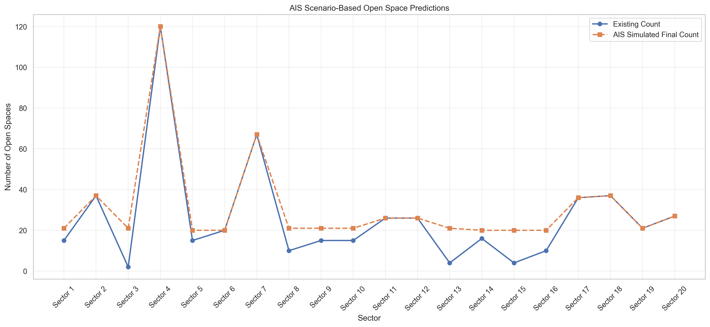

Displays simulated post-allocation outcomes.

### 17.9 PSO Allocation Heatmap

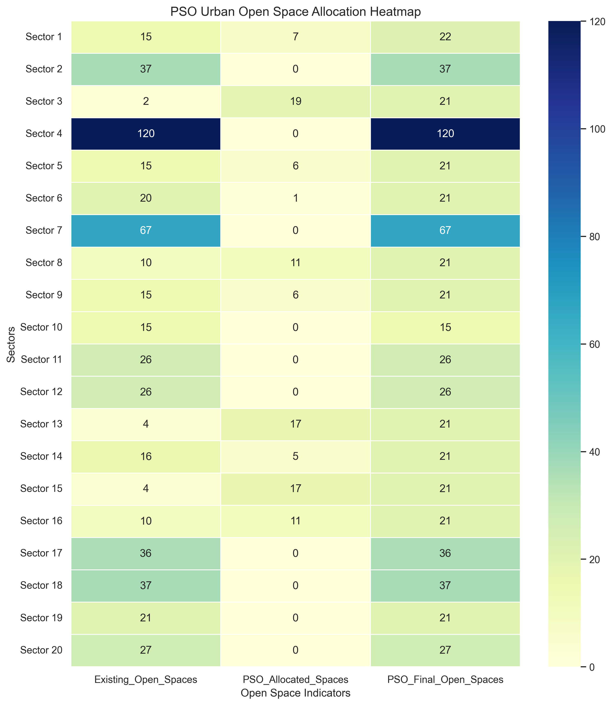

Shows sector-wise PSO allocation results.

### 17.10 PSO Allocation Results

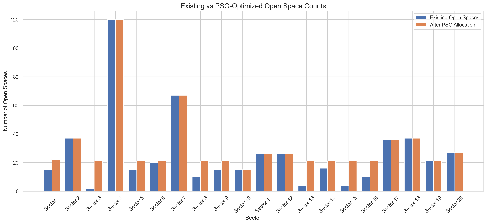

Compares the original distribution with the PSO allocation scenario.

### 17.11 PSO Prediction Results

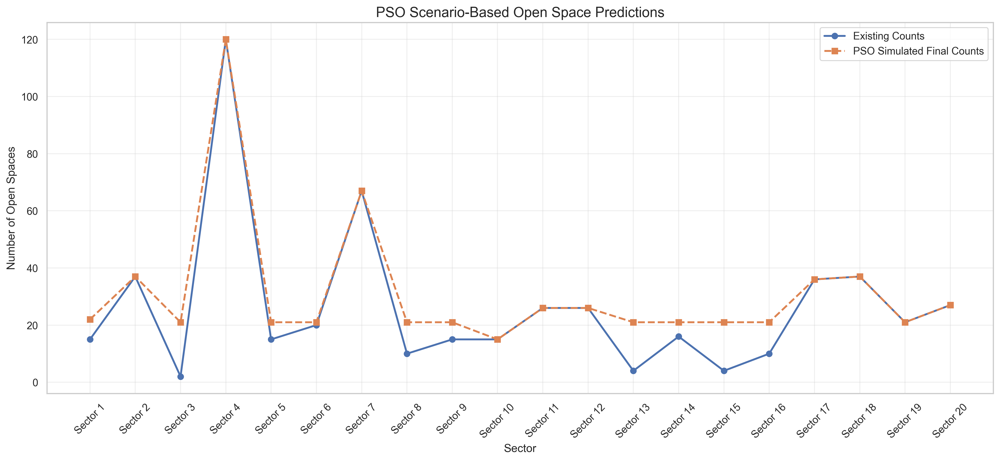

Displays simulated post-allocation counts.

---

## 18. Project Directory Structure

```text
AI-Based Urban Open Space Distribution Analysis
and Green Infrastructure Optimization Using PSO and AIS/
│
├── OpenSpaces_Jalandhar_2.csv
│
├── README.md
│
├── model.pkl
├── model.h5
├── config.yaml
├── results.json
│
├── processed_data.csv
├── sector_analysis.csv
├── model_metrics.csv
├── result.csv
├── prediction.csv
│
├── accuracy_graph.png
├── heatmap.png
├── comparison_graph.png
├── result_graph.png
├── prediction_graph.png
├── residual_graph.png
│
├── ais_model.pkl
├── ais_model.h5
├── ais_config.yaml
├── ais_results.json
├── ais_model_metrics.csv
├── ais_result.csv
├── ais_prediction.csv
├── ais_convergence.csv
│
├── ais_accuracy_graph.png
├── ais_heatmap.png
├── ais_comparison_graph.png
├── ais_result_graph.png
├── ais_prediction_graph.png
├── ais_convergence_graph.png
├── ais_priority_graph.png
│
├── pso_model.pkl
├── pso_model.h5
├── pso_config.yaml
├── pso_results.json
├── pso_model_metrics.csv
├── pso_result.csv
├── pso_prediction.csv
├── pso_convergence.csv
│
├── pso_accuracy_graph.png
├── pso_heatmap.png
├── pso_comparison_graph.png
├── pso_result_graph.png
├── pso_prediction_graph.png
├── pso_convergence_graph.png
│
└── pso_priority_graph.png
```

Files are generated after the corresponding notebooks or scripts are executed successfully.

---

## 19. Installation

### Prerequisites

Install Python 3.10 or later.

Recommended development environments:

- Jupyter Notebook
- JupyterLab
- Visual Studio Code

### Install Dependencies

Open a terminal and execute:

```bash
pip install numpy pandas matplotlib seaborn scikit-learn h5py pyyaml jupyter
```

### Launch Jupyter Notebook

```bash
jupyter notebook
```

Open the project directory and create or load the relevant notebooks.

---

## 20. How to Run the Project

### Step 1: Download or Prepare the Dataset

Place the dataset inside the project directory.

```text
OpenSpaces_Jalandhar_2.csv
```

### Step 2: Configure the Dataset Path

Use the following path in the Python code:

```python
from pathlib import Path

PROJECT_DIR = Path(
    r"C:\Users\sagni\Downloads\AI-Based Urban Open Space Distribution Analysis and Green Infrastructure Optimization Using PSO and AIS"
)

DATASET_PATH = PROJECT_DIR / "OpenSpaces_Jalandhar_2.csv"
```

### Step 3: Run the Data Processing Code

Execute the preprocessing and statistical analysis notebook.

This generates the cleaned dataset and initial analytical artifacts.

### Step 4: Run the Machine Learning Evaluation

Execute the regression evaluation notebook.

It generates:

```text
accuracy_graph.png
heatmap.png
comparison_graph.png
result.csv
result_graph.png
prediction.csv
prediction_graph.png
model_metrics.csv
```

### Step 5: Run AIS Optimization

Execute the AIS implementation.

It generates all `ais_` output files.

### Step 6: Run PSO Optimization

Execute the PSO implementation.

It generates all `pso_` output files.

### Step 7: Review Results

Compare:

```text
model_metrics.csv
ais_model_metrics.csv
pso_model_metrics.csv
```

Inspect the generated graphs and sector-level allocation results.

---

## 21. Output File Descriptions

### Machine Learning Outputs

| File | Description |
|---|---|
| model.pkl | Serialized regression model |
| model.h5 | Model inputs, predictions, and metrics |
| config.yaml | ML configuration |
| results.json | Evaluation results |
| model_metrics.csv | Regression performance |
| result.csv | Out-of-fold predictions |
| prediction.csv | In-sample fitted estimates |

### AIS Outputs

| File | Description |
|---|---|
| ais_model.pkl | Saved AIS optimization solution |
| ais_model.h5 | AIS allocation and convergence data |
| ais_config.yaml | AIS hyperparameters |
| ais_results.json | AIS experiment results |
| ais_result.csv | Sector-wise AIS allocations |
| ais_prediction.csv | Simulated final counts |
| ais_convergence.csv | Generation-wise fitness |
| ais_model_metrics.csv | AIS evaluation metrics |

### PSO Outputs

| File | Description |
|---|---|
| pso_model.pkl | Saved PSO optimization solution |
| pso_model.h5 | PSO allocation and convergence data |
| pso_config.yaml | PSO hyperparameters |
| pso_results.json | PSO experiment results |
| pso_result.csv | Sector-wise PSO allocations |
| pso_prediction.csv | Simulated final counts |
| pso_convergence.csv | Iteration-wise fitness |
| pso_model_metrics.csv | PSO evaluation metrics |

---

## 22. Expected Outcomes

The project is designed to produce:

1. A statistical description of urban open-space counts.
2. Sector-wise distribution visualizations.
3. A regression modeling baseline.
4. Cross-validated regression performance metrics.
5. An AIS-based simulated allocation solution.
6. A PSO-based simulated allocation solution.
7. Comparison against an exact greedy benchmark.
8. Sector-level allocation CSV files.
9. Optimization convergence graphs.
10. Reproducible model and configuration artifacts.

The magnitude of improvement depends on the dataset, optimization settings, and algorithm performance.

No specific improvement percentage is assumed before execution.

---

## 23. Applications

Potential applications include:

### Smart City Planning

Supporting exploratory analysis of sector-level infrastructure distribution.

### Urban Infrastructure Assessment

Identifying areas with relatively low counts of listed open spaces.

### Resource Allocation Research

Studying how metaheuristic algorithms distribute limited resources.

### Decision Support Systems

Providing transparent computational scenarios for planning discussions.

### Environmental Planning Research

Creating a foundation for future integration of green coverage, population, and accessibility indicators.

---

## 24. Project Limitations

### Limited Dataset Size

The dataset contains only 20 sector-level observations.

This restricts the reliability and generalizability of supervised machine learning models.

### Missing Environmental Variables

Important variables are unavailable, including:

- Open-space area
- Tree counts
- Population density
- Land availability
- Geographic coordinates
- Accessibility measurements

### Simulated Allocation Budget

The optimization budget of 100 additional spaces is hypothetical.

It does not represent an approved municipal development plan.

### Simplified Optimization Objective

The current objective minimizes differences in open-space counts.

Equal counts do not necessarily imply equitable access or environmental sustainability.

### Prediction Limitations

The machine learning component does not establish reliable future open-space growth.

The AIS and PSO prediction CSV files represent simulated allocation outcomes rather than forecasts.

### Optimization Benchmark

For the current variance-minimization objective, greedy allocation provides an exact benchmark.

A metaheuristic cannot improve upon the exact optimal objective value.

---

## 25. Future Enhancements

### 25.1 Hybrid AIS-PSO Optimization

Develop a hybrid framework combining:

- PSO global search
- AIS clonal selection
- Hypermutation
- Diversity preservation
- Adaptive parameter adjustment

### 25.2 Population-Aware Optimization

Integrate population information to evaluate open-space availability per resident.

### 25.3 Geographic Information Systems

Use GIS data to study the spatial distribution of open spaces.

### 25.4 Multi-Objective Optimization

Optimize multiple competing objectives, such as:

\[
\min F(X) =
\left[
f_1(X),
f_2(X),
f_3(X)
\right]
\]

Possible objectives include:

- Allocation cost
- Accessibility inequality
- Land-use constraints
- Environmental benefits

### 25.5 Real-Time Urban Data

Integrate municipal infrastructure databases and updated geographic records.

### 25.6 Interactive Dashboard

Develop a dashboard using Streamlit, Dash, or Plotly.

### 25.7 Repeated Experimental Evaluation

Evaluate AIS and PSO over multiple random seeds.

Report:

- Mean objective value
- Standard deviation
- Best and worst solutions
- Runtime
- Convergence speed
- Statistical significance

---

## 26. Research Significance

This project demonstrates how data analysis and nature-inspired optimization can be integrated into an exploratory urban planning framework.

Its main contributions are:

1. A reproducible sector-level open-space analysis pipeline.
2. An experimental machine learning baseline.
3. An AIS-based allocation optimizer.
4. A PSO-based allocation optimizer.
5. A common optimization objective and budget.
6. Comparison against an exact greedy benchmark.
7. Automated generation of evaluation artifacts.

The implementation provides a foundation for further investigation into more realistic and multi-objective urban infrastructure allocation problems.

---

## 27. Reproducibility

The implementation uses a fixed random seed:

```python
SEED = 42
```

The following settings should remain consistent when comparing AIS and PSO:

- Dataset
- Objective function
- Allocation budget
- Capacity constraints
- Evaluation metrics
- Computational environment

For stronger experimental conclusions, independent runs using multiple random seeds are recommended.

The generated YAML and JSON files store experiment configurations and results.

---

## 28. Conclusion

The **AI-Based Urban Open Space Distribution Analysis and Green Infrastructure Optimization Using PSO and AIS** project presents an experimental framework combining statistical analysis, machine learning, and computational optimization.

The machine learning component evaluates sector-level count estimation using regression baselines.

The AIS and PSO components explore alternative allocations of additional open spaces under a fixed simulated budget.

The resulting CSV files, visualizations, configuration files, and serialized artifacts support reproducible analysis and comparison.

Although the current dataset has important limitations, the project provides a useful foundation for future research involving geographic accessibility, population-aware planning, land-use constraints, and hybrid optimization algorithms.

---

## 29. Keywords

Artificial Intelligence, Machine Learning, Urban Open Spaces, Green Infrastructure, Smart Cities, Sustainable Urban Development, Particle Swarm Optimization, PSO, Artificial Immune System, AIS, Clonal Selection, Urban Planning, Resource Allocation, Data Analytics, Optimization, Jalandhar.

---

## 30. Disclaimer

This project is intended for academic, educational, and experimental research purposes.

The optimization results represent simulated sector-level allocation scenarios.

They should not be interpreted as official urban planning recommendations without additional geographic, demographic, environmental, and feasibility data.

---

## License

No license has been specified for this project.

Users should verify the dataset's licensing and usage conditions before redistributing it.

---

## Project Status

**Implemented components:**

- Dataset preprocessing
- Exploratory data analysis
- Machine learning regression evaluation
- AIS optimization
- PSO optimization
- Statistical visualization
- Result export
- Model serialization

**Planned extensions:**

- Hybrid AIS-PSO optimization
- Multi-objective resource allocation
- GIS integration
- Population-adjusted accessibility modeling
- Repeated statistical experiments

---

**Project:** AI-Based Urban Open Space Distribution Analysis and Green Infrastructure Optimization Using PSO and AIS

**Study Area:** Jalandhar, Punjab, India

**Domain:** Artificial Intelligence | Optimization | Smart Cities | Urban Planning
